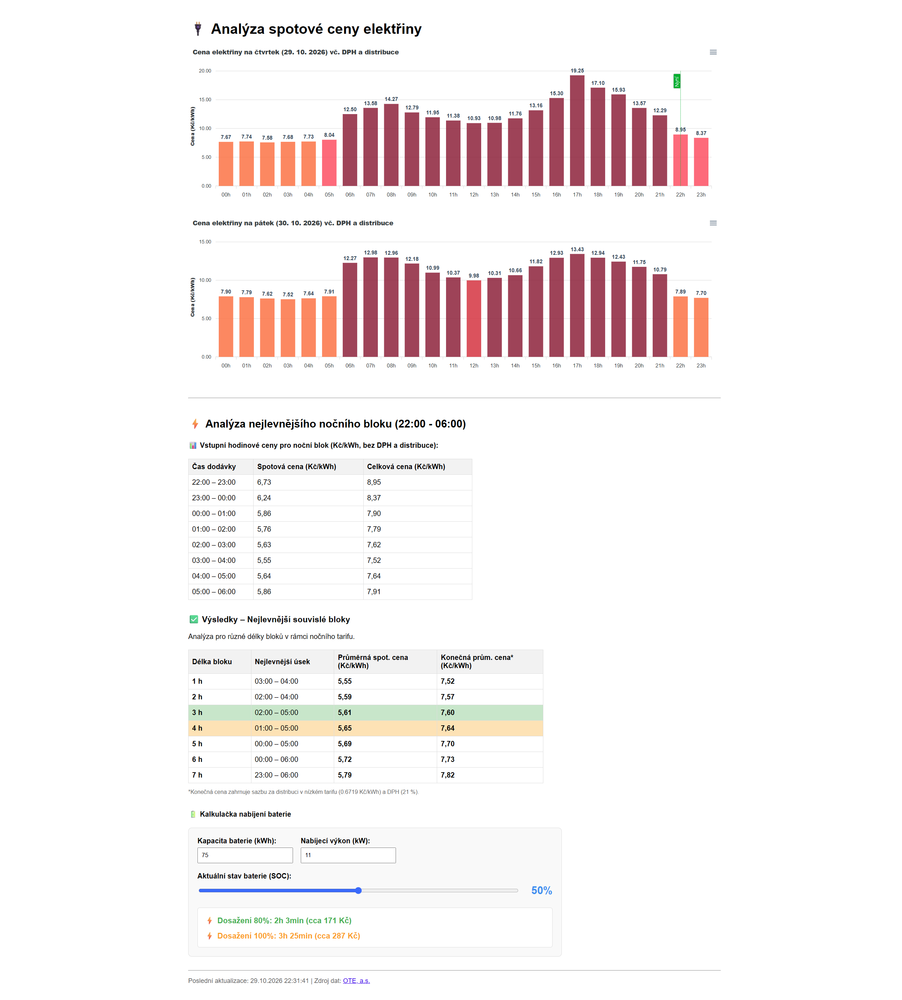

# Analýza spotové ceny elektřiny

Webová stránka v PHP, která z dat OTE zobrazuje hodinové spotové ceny elektřiny na dnešek a zítřek včetně DPH a distribuce. Najde nejlevnější souvislé bloky v nočním tarifu (22:00–06:00) a obsahuje kalkulačku nabíjení baterie.

Zdroj dat: [OTE, a.s.](https://www.ote-cr.cz/)
